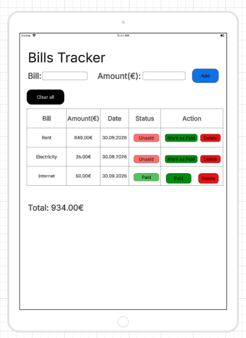
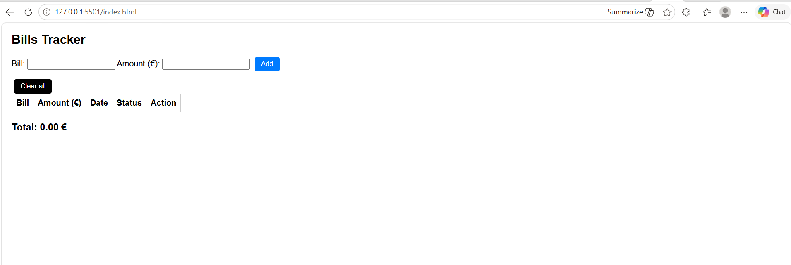

# Project name

**Author(s):** David Muli

## Project plan

Bills Tracker

### Project idea

Bills Tracker is a simple and easy to use bills management app for people who receive multiple bills and who want to monitor and manage their bills in one place so as to avoid falling behind bills payment.

### Planned features

-A feature that allows to add new bills by name and amount
-A feature that shows bill’s status as paid after a bill is marked as paid. If a bill is not yet   marked as paid, it shows “unpaid”
-A feature that gives individuals an option to delete bills individually or all.

### Wireframe / sketch

## Web links

- **Published application:** [Add your GitHub Pages URL here](https://yourusername.github.io/your-repository/)
- **GitHub repository:** [Add your repository URL here](https://github.com/yourusername/your-repository)
- **Project video presentation:** [https://teams.cloud.microsoft/l/meetingrecap?driveId=b%21dLmCPBbICUycnvt0bPP8WfEgzFrzr-JMsyZHUo1z1J8kje3tEViYSYr58DyrTGP6&driveItemId=015TMGDLQXQ3SZJLA2AFCKALVB4C5FWZSF&sitePath=https%3A%2F%2Flaureauas-my.sharepoint.com%2F%3Av%3A%2Fg%2Fpersonal%2Fdam00022_laurea_fi%2FIQAXhuWUrBoBRKAuoeC6W2ZFAfc7muz5tel7k2h6R71BMyA&fileUrl=https%3A%2F%2Flaureauas-my.sharepoint.com%2Fpersonal%2Fdam00022_laurea_fi%2FDocuments%2FTallenteet%2FWeb+Development+Frontend+Project+1-20261027_163249-Meeting+Recording.mp4%3Fweb%3D1&iCalUid=040000008200E00074C5B7101A82E00800000000B2F8FD931C66DD0100000000000000001000000017BEB13122EC684390F85E8CBC8C3824&threadId=19%3Ameeting_NjI3MDkwNWYtMjdlMy00ZDNjLWIyZDktY2U1NWFhNWNhZDhi%40thread.v2&organizerId=e263a8a0-b8a8-4e6b-a6d8-f7ce67744c3d&tenantId=f0b9e9d7-8d66-4b16-9c1c-6b07c4796280&callId=62a54c3e-12eb-4d1a-ad0f-0691a84b4af5&threadType=Meeting&meetingType=Scheduled&subType=RecapSharingLink_RecapCore&recapType=RecordingAndTranscript]

## About the application

**[Bills Tracker]** is a web application that allows users to add a bill's name, specify an amount and then a table of the bills populates beneath with information such as: Bill, amount, date, status and action. A bill can be marked paid or unpaid and can be deleted individually or together with other bills.

## Technologies

I used HTML5 for the page structure  of Bills Tracker. Specifically I used it for structuring the form inputs, form buttons and the form’s table. I used CSS for styling and layout especially when I was defining the button colors of the form for defining the payment status labels i.e. paid and unpaid. I used JavaScript for DOM manipulation where the bills table and payment status update dynamically, functionality and form validation. I also used localStorage for saving and restoring the bills in the browser.

## How to use the application

1. Open the published application using the link above.
2. Enter a bill name and amount then click add
3. Use mark as paid when a bill has been paid
4. Click delete if you want to remove an individual bill or click clear all if you want to remove all the bills
5.  Refresh the page and check whether your saved bills remain available in the browser

## Running the application locally

1. Clone or download this repository to your computer.
2. Open the project folder.
3. Open `index.html` in a web browser.

## Screenshots

## Known issues / limitations

1. The application does not support editing existing bills so when a user enters a correct bill with a wrong amount, the user has to delete the whole entry and start all over again by entering the correct bill name and amount.
2. There is no confirmation message for example when a user deletes a bill. This might lead to unintended data loss.
3. This application was a low fidelity application that is typical of a university project and it includes the MVP features that supports its functionality, layout and basic interactions not complicated visuals. Beyond this, future improvements could include advanced features such as search function, due date reminders, filtering options and visual graphs or analytics view that can communicate spending insights to the user.
4. This application mainly focused on the user interaction with the form and therefore, navigation buttons and how they connect from one page to another, such as the user interface that contains log in information that would take users to the main form was left out.

## Self-assessment and learning reflection

I am pleased with how my Bills Tracker turned out. Users can add bills, validate input, update payment statuses, calculate totals, and save data using localStorage. Getting these features to work together made me more confident in my programming skills.

The challenging part was getting the table to update properly whenever I added, paid, or deleted a bill. Working through this helped me understand how the DOM works and how HTML, CSS, and JavaScript all connect. I also learned how to keep my data saved even after refreshing the page.

With more time, I would add editing, sorting, filtering, and due-date reminders. I would also like to improve my JavaScript code organization and learn to display expenses using charts.

My self-assessed grade is 10/10 because I successfully met all the six grading criteria outlined in Canvas.There is still room for improvement, but I’m happy with how the project turned out and with everything I learned while building it.

## Sources and acknowledgements

List all sources, tutorials, images and code examples used in your project.

If you used ChatGPT, GitHub Copilot or another AI tool, mention it here and briefly explain how it supported your work.

- [MDN Web Docs](https://developer.mozilla.org/en-US/docs/Web/JavaScript)
- [Freecodecamp JavaScript Certification](https://www.freecodecamp.org/learn/javascript-v9/)
- [Bro Code JavaScript Full Course for free](https://www.youtube.com/watch?v=lfmg-EJ8gm4)
- [How to create wireframes in Lucidcharts (step by step)](https://www.youtube.com/watch?v=jTDGdpcbXGs)
- [Bills Tracker wireframe Image](https://lucid.app/lucidchart/0d0b7617-407a-4f81-8400-82b12f14181f/edit?viewport_loc=-2510%2C-1112%2C3699%2C1958%2C0_0&invitationId=inv_7990035d-7c1d-4b92-bc8a-7cd88aba02f4)
- AI tool used: Copilot
  - How the tool was used: Copilot helped me understand why my external JavaScript file wasn’t interacting with my HTML when the <script src="js/script.js"> tag was placed in the <head>. It explained that scripts load before the DOM unless defer is used and recommended placing the script at the end of the <body> for proper functionality. Copilot also supported me in fixing validation issues and clarifying how DOM manipulation updates the table as well as helping me understand how my JavaScript functions connect with the HTML.

## License

MIT License

Copyright (c) 2026 davidkimulimuli

Permission is hereby granted, free of charge, to any person obtaining a copy
of this software and associated documentation files (the "Software"), to deal
in the Software without restriction, including without limitation the rights
to use, copy, modify, merge, publish, distribute, sublicense, and/or sell
copies of the Software, and to permit persons to whom the Software is
furnished to do so, subject to the following conditions:

The above copyright notice and this permission notice shall be included in all
copies or substantial portions of the Software.

THE SOFTWARE IS PROVIDED "AS IS", WITHOUT WARRANTY OF ANY KIND, EXPRESS OR
IMPLIED, INCLUDING BUT NOT LIMITED TO THE WARRANTIES OF MERCHANTABILITY,
FITNESS FOR A PARTICULAR PURPOSE AND NONINFRINGEMENT. IN NO EVENT SHALL THE
AUTHORS OR COPYRIGHT HOLDERS BE LIABLE FOR ANY CLAIM, DAMAGES OR OTHER
LIABILITY, WHETHER IN AN ACTION OF CONTRACT, TORT OR OTHERWISE, ARISING FROM,
OUT OF OR IN CONNECTION WITH THE SOFTWARE OR THE USE OR OTHER DEALINGS IN THE
SOFTWARE.