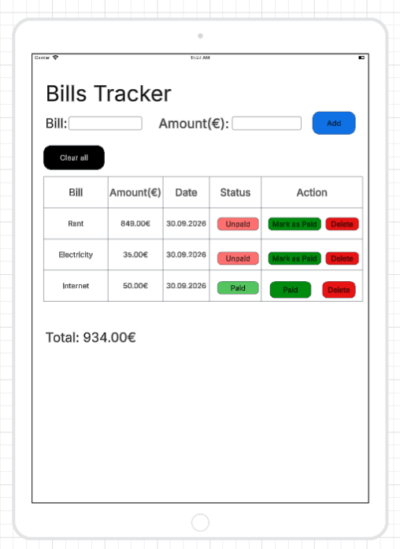
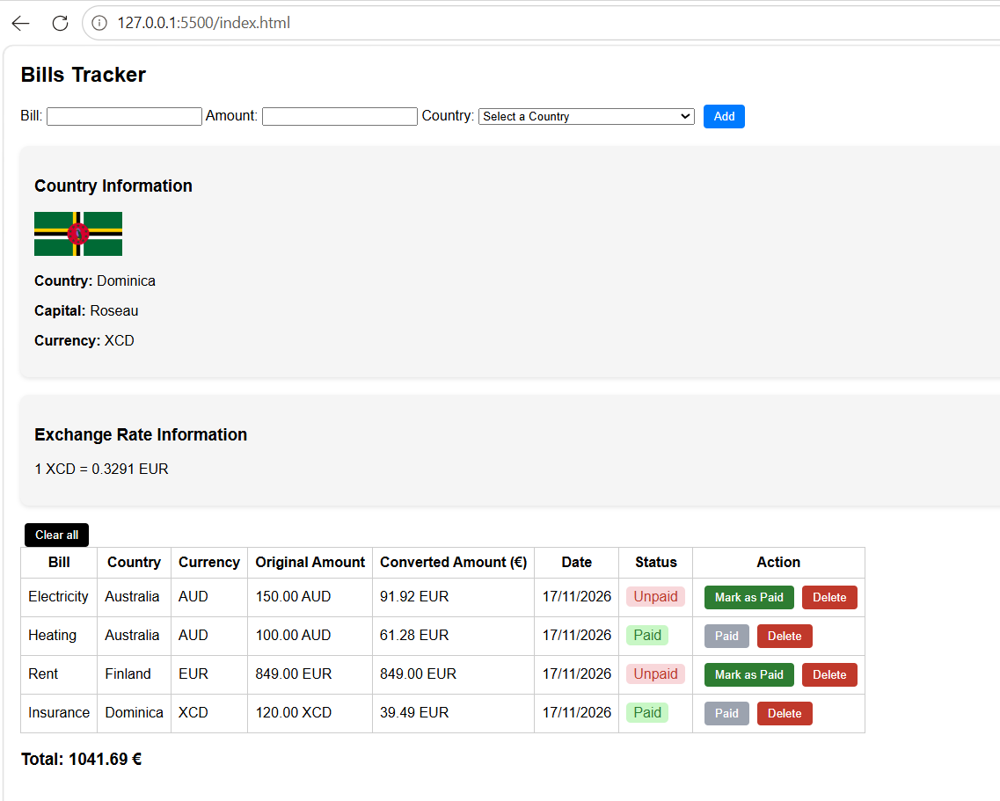

# Project name

**Author(s):** David Muli

## Project plan

Bills Tracker

### Project idea

Bills Tracker is a simple and easy to use bills management app for people who receive multiple bills and who want to monitor and manage their bills in one place so as to avoid falling behind bills payment.

In Version 2, the app also supports people who receive bills in different countries and currencies. Each bill is linked to a country, and its amount is converted to euros so that all bills can be added together in one total.

I chose EURO to simplify my explanation for this application. Other currencies such as USD, AUD etc. can be incorporated in this Bills tracker app however, the code might turn out to be complex for this assignment needs.In addition, I wanted to keep my UI simpler.

### APIs used
Version 2 of this application utilized two APIs. 

1. Rest countries API - for making the different countries available to be selected. The documentation of rest countries API only allows 100 countries for the free version which I utilized in this application. The last country is Hong Kong

2. Frankfurter API - for enabling the exchange rate function

### Planned features

-A feature that allows to add new bills by name and amount
-A feature that shows bill’s status as paid after a bill is marked as paid. If a bill is not yet   marked as paid, it shows “unpaid”
-A feature that gives individuals an option to delete bills individually or all.

Version 2 - (NEW FEATURES)
The main aim of these new features in version 2 was to make the Bills Tracker application more useful, realistic and available worldwide instead of one geographical location i.e. Finland. The new features include: 
-A feature that allows the user to select a country for each bill 
-A feature that shows country information (flag, capital city and currency) after a country is selected 
-A feature that shows the current exchange rate from the country's currency to euros 
-A feature that converts each bill's amount to euros and calculates the total in euros
-For aesthetics, the UI was made appealing by including the coutry card and currency exchange card

### Wireframe / sketch

## Web links

- **Published application:** [https://davidkimulimuli.github.io/Project-1---Bills-Tracker/]
- **GitHub repository:** [https://github.com/davidkimulimuli/Project-1---Bills-Tracker]
- **Project video presentation:** [https://laureauas-my.sharepoint.com/:v:/r/personal/dam00022_laurea_fi/Documents/Tallenteet/Project%202a%20-%20Web%20Development%20Front%20end-20261117_211519-Meeting%20Recording.mp4?d=w6052b9321cdf4d54b9e32a5fb396a4cf&csf=1&web=1&e=Jz1m2K&nav=eyJyZWZlcnJhbEluZm8iOnsicmVmZXJyYWxBcHAiOiJTdHJlYW1XZWJBcHAiLCJyZWZlcnJhbFZpZXciOiJTaGFyZURpYWxvZy1MaW5rIiwicmVmZXJyYWxBcHBQbGF0Zm9ybSI6IldlYiIsInJlZmVycmFsTW9kZSI6InZpZXcifX0%3D]

## About the application

**[Bills Tracker]** is a web application that allows users to add a bill's name, specify an amount and then a table of the bills populates beneath with information such as: Bill, amount, date, status and action. A bill can be marked paid or unpaid and can be deleted individually or together with other bills.

## What changed in version 2 and why?

Version 1 only handled a bill's name and amount in one specific currency. This made it impossible to add up bills from different countries correctly, because 100 in one currency is not worth the same as 100 in another. Version 2 solves this by connecting two free APIs and saving more information about each bill.

## Technologies

I used HTML5 for the page structure  of Bills Tracker. Specifically I used it for structuring the form inputs, form buttons and the form’s table. I used CSS for styling and layout especially when I was defining the button colors of the form for defining the payment status labels i.e. paid and unpaid. I used JavaScript for DOM manipulation where the bills table and payment status update dynamically, functionality and form validation. I also used localStorage for saving and restoring the bills in the browser.

Version 2
In Version 2, I also used CSS to style the country and exchange rate information cards.

I also added two APIs that I call from JavaScript with the Fetch API:

1. REST Countries API for the list of countries, and for each country's capital, flag and currency
2. Frankfurter API for the exchange rate from the country's currency to euros

## How to use the application

1. Open the published application using the link above.
2. Enter a bill name and amount then click add
3. Use mark as paid when a bill has been paid
4. Click delete if you want to remove an individual bill or click clear all if you want to remove all the bills
5.  Refresh the page and check whether your saved bills remain available in the browser

## How to use the application VERSION 2 UPDATE:
1. Open the published application using the link above.
2. Enter a bill name and amount
3. Select a country from the dropdown. The country information and the exchange rate appear.
4. Click add. The bill appears in the table with its original amount and its converted amount in euros.
5 .Use mark as paid when a bill has been paid
6. Click delete if you want to remove an individual bill or click clear all if you want to remove all the bills
7 . Refresh the page and check whether your saved bills remain available in the browser

An internet connection is needed to load the countries and the exchange rates.

## Running the application locally

1. Clone or download this repository to your computer.
2. Open the project folder.
3. Open `index.html` in a web browser.

## Screenshots

## Known issues / limitations

1. The application does not support editing existing bills so when a user enters a correct bill with a wrong amount, the user has to delete the whole entry and start all over again by entering the correct bill name and amount.
2. There is no confirmation message for example when a user deletes a bill. This might lead to unintended data loss.
3. This application was a low fidelity application that is typical of a university project and it includes the MVP features that supports its functionality, layout and basic interactions not complicated visuals. Beyond this, future improvements could include advanced features such as search function, due date reminders, filtering options and visual graphs or analytics view that can communicate spending insights to the user.
4. This application mainly focused on the user interaction with the form and therefore, navigation buttons and how they connect from one page to another, such as the user interface that contains log in information that would take users to the main form was left out.

## VERSION 2 ADDITIONAL KNOWN ISSUES / LIMITATIONS
1. The country and exchange rate features depend on the two APIs. If an API is unavailable or the user is offline, the country information or the exchange rate does not load, and the converted amount of a new bill may be wrong.
2. Only the first 100 countries from the REST Countries API are loaded into the dropdown, and when a country has more than one currency, the app uses the first one.
3. The exchange rate is saved when the bill is added, so it does not update later when the rate changes.
4. The REST Countries API key is stored in the front-end JavaScript, which is not secure for a public project. A backend or a proxy should be used to hide it in a real application.

## Self-assessment and learning reflection

I am pleased with how my Bills Tracker turned out. Users can add bills, validate input, update payment statuses, calculate totals, and save data using localStorage. Getting these features to work together made me more confident in my programming skills.

The challenging part was getting the table to update properly whenever I added, paid, or deleted a bill. Working through this helped me understand how the DOM works and how HTML, CSS, and JavaScript all connect. I also learned how to keep my data saved even after refreshing the page.

With more time, I would add editing, sorting, filtering, and due-date reminders. I would also like to improve my JavaScript code organization and learn to display expenses using charts.

My self-assessed grade is 10/10 because I successfully met all the six grading criteria outlined in Canvas.There is still room for improvement, but I’m happy with how the project turned out and with everything I learned while building it.

## Self-assessment and learning reflection VERSION 2

In Version 2, the challenging part was working with APIs. I learned how to use fetch with async / await, how to read the JSON data that an API returns, how to handle errors, and how to combine data from two different APIs to convert the bill amounts.

I also learned that it is not enough to simply copy and paste API keys from the API key providers because every API service provider has unique configuration rules. One needs to read the documentation and see excactly how the API key is implemented in the code. For instance, my REST countries API was not allowing traffic so I had to search and find out why and how to allow traffic.

My self-assessed project grade is 10/10 as I have fulfiled all the required deliverables for project 2a

## Sources and acknowledgements

List all sources, tutorials, images and code examples used in your project.

If you used ChatGPT, GitHub Copilot or another AI tool, mention it here and briefly explain how it supported your work.

- [MDN Web Docs](https://developer.mozilla.org/en-US/docs/Web/JavaScript)
- [REST Countries API](https://restcountries.com/api-keys)
- [Frankfurter API](https://frankfurter.dev/)
- [Freecodecamp JavaScript Certification](https://www.freecodecamp.org/learn/javascript-v9/)
- [Bro Code JavaScript Full Course for free](https://www.youtube.com/watch?v=lfmg-EJ8gm4)
- [How to create wireframes in Lucidcharts (step by step)](https://www.youtube.com/watch?v=jTDGdpcbXGs)
- [Bills Tracker wireframe Image](https://lucid.app/lucidchart/0d0b7617-407a-4f81-8400-82b12f14181f/edit?viewport_loc=-2510%2C-1112%2C3699%2C1958%2C0_0&invitationId=inv_7990035d-7c1d-4b92-bc8a-7cd88aba02f4)
- AI tool used: Copilot
  - How the tool was used: Copilot helped me understand why my external JavaScript file wasn’t interacting with my HTML when the <script src="js/script.js"> tag was placed in the <head>. It explained that scripts load before the DOM unless defer is used and recommended placing the script at the end of the <body> for proper functionality. Copilot also supported me in fixing validation issues and clarifying how DOM manipulation updates the table as well as helping me understand how my JavaScript functions connect with the HTML.

  Version 2 AI use disclosure
  I used Copilot to understand the code. Some of the code presented here is complex. I got to understand the code better by using explanations provided by AI. Sometimes I got stuck with errors in the console and I tapped into AI for explanations on why I got stuck and the reasoning behind. Since I was adding new features in my existing code, I also used AI for the work flow i.e. where some of the new features appeared as it was not obvious.

## License

MIT License

Copyright (c) 2026 davidkimulimuli

Permission is hereby granted, free of charge, to any person obtaining a copy
of this software and associated documentation files (the "Software"), to deal
in the Software without restriction, including without limitation the rights
to use, copy, modify, merge, publish, distribute, sublicense, and/or sell
copies of the Software, and to permit persons to whom the Software is
furnished to do so, subject to the following conditions:

The above copyright notice and this permission notice shall be included in all
copies or substantial portions of the Software.

THE SOFTWARE IS PROVIDED "AS IS", WITHOUT WARRANTY OF ANY KIND, EXPRESS OR
IMPLIED, INCLUDING BUT NOT LIMITED TO THE WARRANTIES OF MERCHANTABILITY,
FITNESS FOR A PARTICULAR PURPOSE AND NONINFRINGEMENT. IN NO EVENT SHALL THE
AUTHORS OR COPYRIGHT HOLDERS BE LIABLE FOR ANY CLAIM, DAMAGES OR OTHER
LIABILITY, WHETHER IN AN ACTION OF CONTRACT, TORT OR OTHERWISE, ARISING FROM,
OUT OF OR IN CONNECTION WITH THE SOFTWARE OR THE USE OR OTHER DEALINGS IN THE
SOFTWARE.

